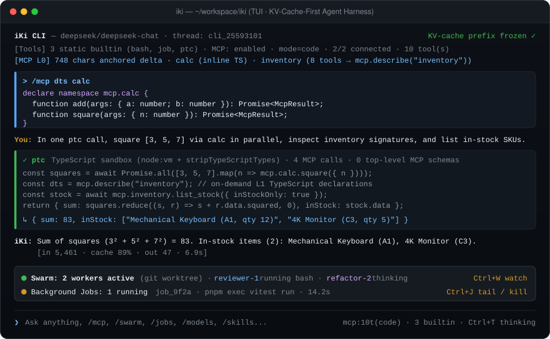
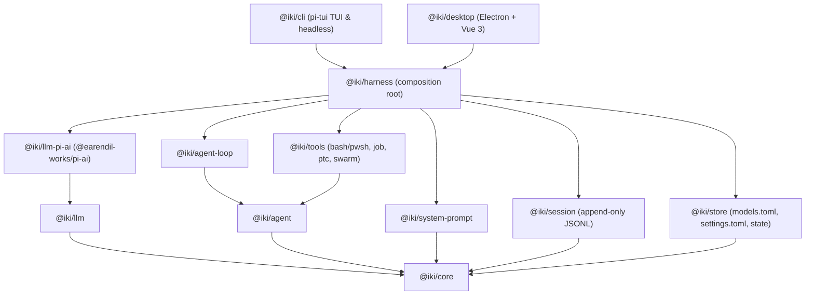

# iKi

**A KV-cache-native AI agent harness with MCP Code Mode, a TypeScript PTC sandbox, and live-observable multi-agent swarms.**

English | [简体中文](./README.zh-CN.md)

[](https://www.npmjs.com/package/@irorange27/iki)
[](https://nodejs.org/)
[](https://www.typescriptlang.org/)
[](./LICENSE)

<p align="center">
  
</p>

> A strictly layered TypeScript harness (`packages/core` .. `packages/harness`) powering a standalone zero-dependency terminal TUI (`@irorange27/iki`) and a macOS Electron app (`@iki/desktop`).

---

## Why iKi?

Most coding agents share the same basic shell loop, yet quietly waste tokens on broken prompt caches, bloat context windows with raw MCP schemas, and turn parallel work into a black box. iKi focuses on three concrete engineering problems:

### 1. KV-Cache-First Context Layout
- **Frozen static prefix:** The system prompt (`persona` → rules → `<project_context>` → `<skills>`) and the **3 core top-level tools** (`bash`/`pwsh`, `job`, `ptc`) stay byte-identical across turns.
- **Anchored delta reminders:** Dynamic facts (runtime workspace, newly loaded skills, MCP connect/disconnect changes) are injected as anchored `role: 'user'` `<system_reminder>` messages — never mutating earlier turns or system text.
- **Session-pinned prompt caching:** Every call forwards `sessionId: threadId` and replays multi-step tool turns chronologically as `[assistant, tool, assistant, ...]` without double-wrapping outputs.

### 2. MCP Code Mode + TypeScript PTC Sandbox
Connecting 2–3 MCP servers to a typical agent dumps dozens of raw JSON Schemas into every request — burning prompt tokens, hurting tool selection, and busting prompt caches whenever servers change.

iKi defaults to **MCP Code Mode** (`[mcp].exposureMode = "code"`):
- **L0 Progressive Disclosure:** Small servers (≤ 6 tools) inline compact single-line TypeScript signatures; larger servers expose only a tool-name index + `mcp.describe("<server>")` hint. *(Live measurement with 2 stdio MCP servers / 10 tools: **748 chars total**, 0 top-level MCP JSON schemas.)*
- **L1 On-Demand `.d.ts`:** The model (or `/mcp dts` in CLI) inspects generated `declare namespace mcp.<server> { ... }` declarations only when needed.
- **L2 Programmatic Tool Calling (`ptc`):** Inside an isolated `node:vm` sandbox powered by Node 24's built-in `stripTypeScriptTypes` (zero external compiler deps), the model writes short TypeScript snippets to batch, loop, filter, and call `await Promise.all([mcp.github.list_issues(...), ...])` in **one turn**.
- **Drop-in MCP import:** Import existing Claude Desktop / Cursor `.mcp.json` configs via `/mcp import`, or toggle back to top-level schemas anytime via `/mcp mode direct`.

### 3. Live-Observable Multi-Agent Swarm & Durable Jobs
- **Git-worktree isolation:** Spawn parallel workers in `inherit`, `share` (dedicated `git worktree`), or `branch` (isolated clone) workspaces, coordinated over an incremental shared message board.
- **Role-based model mixing:** Pair a stronger coordinator model with faster/cheaper worker models per role.
- **Live TUI visibility:** Watch active workers, live tool calls, thinking traces, and durable background shell jobs in real time via the activity strip and full-screen watch views (`Ctrl+W` / `Ctrl+J`).

---

## Comparison

| Dimension | Traditional Coding Agents / Raw MCP | iKi |
|---|---|---|
| **MCP Context Footprint** | Full JSON Schema for every MCP tool sent on every turn | **MCP Code Mode**: compact TS signatures + progressive delta (`748 chars` for 10 tools) |
| **Multi-Tool Chaining** | 1 tool call per LLM round-trip; raw payloads bloat history | **`ptc` TypeScript sandbox**: `Promise.all` parallel calls + local filtering in 1 turn |
| **KV-Cache Stability** | Dynamic prompts / mutating tool lists bust prefix cache | Frozen `systemPrompt` + static 3-tool set + anchored `<system_reminder>` deltas |
| **Multi-Agent Visibility** | Hidden sub-agents or manual tmux juggling | Built-in `git worktree` Swarm + shared board + live `Ctrl+W` / `Ctrl+J` watch views |

---

## Quick Start

**Requirement:** **Node.js 24+**.

### Install via npm (Zero Runtime Dependencies)

```bash
npm install -g @irorange27/iki
iki
```

Or run directly without global install:

```bash
npx @irorange27/iki
```

On first launch, export any API key (`ANTHROPIC_API_KEY`, `OPENAI_API_KEY`, `DEEPSEEK_API_KEY`, `OPENROUTER_API_KEY`, `GEMINI_API_KEY`, `KIMI_API_KEY`, or `IKI_BASE_URL` + `IKI_API_KEY`) for zero-config startup, or follow the built-in setup wizard (`iki setup`). Type `/help` inside the TUI for interactive commands.

### macOS Desktop App

Download the latest Apple Silicon `.dmg` from [**GitHub Releases**](https://github.com/irorange27/iKi/releases/latest).

### From Source

```bash
git clone https://github.com/irorange27/iKi.git
cd iKi
corepack enable && pnpm install --frozen-lockfile
pnpm cli        # terminal TUI
pnpm app:dev    # macOS Electron app
```

---

## Architecture

All business logic lives in pure Node/TypeScript packages; `@iki/cli` and `@iki/desktop` are thin presentation shells. One-way dependency rules are enforced on every commit by [`.dependency-cruiser.cjs`](./.dependency-cruiser.cjs) and `knip --production`:



### Monorepo Packages (`packages/`)

| Package | Role |
|---|---|
| `core` | Leaf contracts: Zod schemas (`settings.toml`, `models.toml`), paths, logger, action risk |
| `theme` | Base46 theme presets & schema |
| `store` | Local TOML/JSON config & state persistence (`~/.iki/`) |
| `session` | Append-only `SessionEvent` JSONL log (`~/.iki/sessions/<threadId>.jsonl`) |
| `system-prompt` | Static system prompt slot assembler & dynamic `<system_reminder>` snapshots |
| `llm` | Model-neutral transcript types, chronological UI ↔ `ModelMessage` replay |
| `llm-pi-ai` | `@earendil-works/pi-ai` adapter, model discovery, `sessionId` affinity & prompt-cache retention |
| `agent` | Tool & step contracts (`BaseTool`, `ToolRegistry`, `AgentStep`, `AgentHooks`) |
| `agent-loop` | Pure multi-step tool-calling loop (`runAgentLoop`) |
| `tools` | Pluggable built-in tools (`shell`/`job`, TypeScript `ptc` sandbox + `.d.ts` compiler, `swarm`) |
| `harness` | Composition root: `thread_session`, `turn_prep`, `mcp` (Code Mode + delta), `swarm`, `workspaces` |
| `cli` | Fullscreen `pi-tui` interactive REPL, live watch views, onboarding wizard, standalone npm bundle |
| `desktop` | Thin macOS Electron + Vue 3 shell (main / preload / renderer) |

---

## Development & Verification

```bash
pnpm run ci:quality                   # eslint, tsc, vue-tsc, dependency-cruiser, knip --production
pnpm exec vitest run packages/*/tests # unit & integration tests
pnpm run test:e2e:cli:faux            # deterministic keyless CLI E2E
pnpm run cli:pack                     # build & pack standalone @irorange27/iki tarball
```

---

## License

[AGPLv3](./LICENSE)
