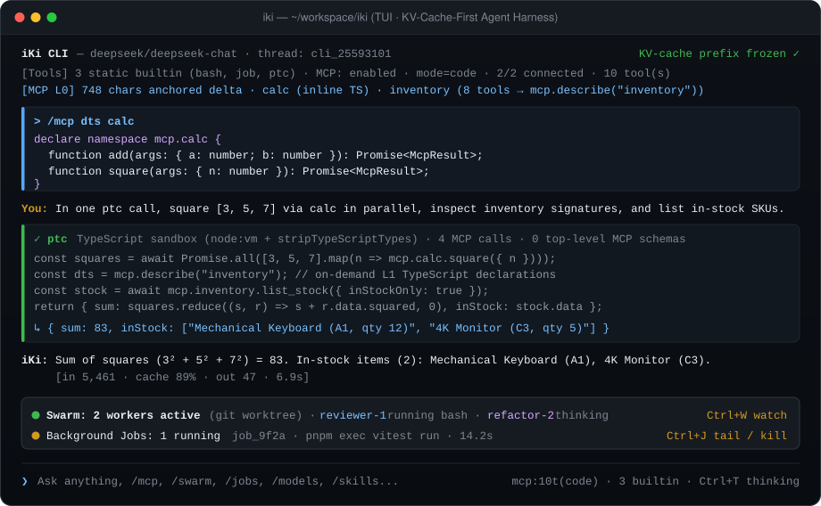
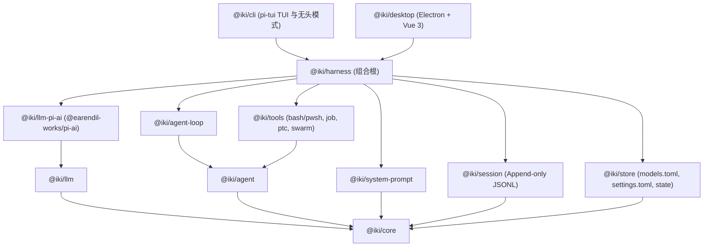

# iKi

**KV-Cache 原生的开源 AI Agent Harness —— 内置 MCP Code Mode、TypeScript PTC 沙箱与实时可观测的多 Agent Swarm。**

[English](./README.md) | 简体中文

[](https://www.npmjs.com/package/@irorange27/iki)
[](https://nodejs.org/)
[](https://www.typescriptlang.org/)
[](./LICENSE)

<p align="center">
  
</p>

> 一套严格分层的纯 Node/TypeScript Agent Harness（`packages/core` .. `packages/harness`），驱动零运行时依赖的独立终端 TUI（`@irorange27/iki`）与 macOS Electron 桌面端（`@iki/desktop`）。

---

## 为什么选择 iKi？

基础的模型接入和 shell 循环各家都有，但一旦进入多轮长任务、接上多个 MCP Server 或开启多 Agent 并行，大多数工具就会悄悄打废 Prompt Cache、把上下文塞满几万字符的 JSON Schema，并且让执行过程变成黑盒。iKi 重点解决三个具体工程问题：

### 1. KV-Cache 原生上下文布局
- **静态前缀冻结**：系统提示词（`persona` → 规则 → `<project_context>` → `<skills>`）以及 **3 个固定顶层工具**（`bash`/`pwsh`、`job`、`ptc`）跨轮次保持字节级稳定。
- **增量锚定提醒**：动态变化信息（工作区、按需技能、MCP 连接/断开变化）全部以锚定在对应 `user` 消息前的 `<system_reminder>` 注入，绝不回头篡改历史前缀。
- **会话亲和与严格时间序回放**：每次调用透传 `sessionId: threadId`，多步工具调用严格按 `[assistant, tool, assistant, ...]` 回放。

### 2. MCP Code Mode + TypeScript PTC 沙箱
传统 Agent 只要接上 2–3 个 MCP Server，每轮都会把几十上百个工具的完整 JSON Schema 塞进顶层 `tools`，既烧 Token、又干扰选工具，还随时击穿缓存。

iKi 默认开启 **MCP Code Mode**（`[mcp].exposureMode = "code"`）：
- **L0 渐进式披露**：小服务（≤ 6 工具）内联单行紧凑 TS 签名；大服务只提供工具名索引 + `mcp.describe("<server>")` 按需查询提示。*（实测同时挂载 2 个 stdio MCP Server / 10 个工具，首次增量提醒仅占 **748 字符**，顶层 0 个 MCP JSON Schema。）*
- **L1 按需查看 `.d.ts`**：模型（或 CLI 内 `/mcp dts`）按需读取自动生成的 `declare namespace mcp.<server> { ... }` 声明。
- **L2 编程式工具调用（`ptc`）**：基于 Node 24 原生 `stripTypeScriptTypes` + `node:vm` 隔离沙箱（零外部编译依赖），模型可以直接写几行 TypeScript 脚本，用 `await Promise.all([mcp.github.list_issues(...), ...])` 在 **1 轮内并发调用、循环过滤并聚合结果**。
- **直接导入现有配置**：通过 `/mcp import` 导入 Claude Desktop / Cursor 格式的 `mcp.json`；需要时随时 `/mcp mode direct` 切回直出模式。

### 3. 实时可观测的多 Agent Swarm 与持久化后台任务
- **Git Worktree 隔离并发**：支持 `inherit`、`share`（独立 `git worktree`）、`branch`（独立克隆）工作区隔离，Worker 间通过增量共享消息板协作。
- **按角色混搭模型**：协调者用强模型、并行 Worker 用快/便宜模型。
- **低心智负担实时看板**：底部活动条实时展示各 Worker 工具调用/思考状态与后台任务进度，支持一键 `Ctrl+W` / `Ctrl+J` 进入全屏实时监控。

---

## 核心差异对比

| 维度 | 传统 Coding Agent / 原生 MCP | iKi |
|---|---|---|
| **MCP 上下文开销** | 每轮全量塞入所有 MCP 工具 JSON Schema | **MCP Code Mode**：紧凑 TS 签名 + 渐进增量披露（10 工具仅 **748 字符**） |
| **多工具编排** | 每轮串行调工具，原始大输出污染历史 | **`ptc` TS 沙箱**：`Promise.all` 并发调用 + 脚本本地过滤，1 轮出结果 |
| **KV-Cache 命中** | 动态系统提示词 / 变化工具列表频繁击穿缓存 | 冻结 `systemPrompt` + 冻结 3 核心工具 + 锚定 `<system_reminder>` 增量 |
| **多 Agent 可观测性** | 后台黑盒，或手工切多个 tmux 窗口 | 原生 `git worktree` Swarm + 实时活动条 + `Ctrl+W` / `Ctrl+J` 看板 |

---

## 快速上手

**环境要求**：**Node.js 24+**。

### 通过 npm 安装（零运行时依赖）

```bash
npm install -g @irorange27/iki
iki
```

或免全局安装直接运行：

```bash
npx @irorange27/iki
```

首次启动时，若终端已有主流 API Key（`ANTHROPIC_API_KEY`、`OPENAI_API_KEY`、`DEEPSEEK_API_KEY`、`OPENROUTER_API_KEY`、`GEMINI_API_KEY`、`KIMI_API_KEY` 或 `IKI_BASE_URL` + `IKI_API_KEY`）会自动完成配置；否则直接进入交互式配置向导（`iki setup`）。进入终端后输入 `/help` 查看全部交互命令。

### macOS 桌面端

前往 [**GitHub Releases**](https://github.com/irorange27/iKi/releases/latest) 下载 Apple Silicon `.dmg`。

### 从源码运行

```bash
git clone https://github.com/irorange27/iKi.git
cd iKi
corepack enable && pnpm install --frozen-lockfile
pnpm cli        # 终端 TUI
pnpm app:dev    # macOS Electron 桌面端
```

---

## 架构概览

所有业务逻辑均位于纯 Node/TypeScript workspace 包中，`@iki/cli` 与 `@iki/desktop` 只是薄展示壳；单向依赖边界由 [`.dependency-cruiser.cjs`](./.dependency-cruiser.cjs) 与 `knip --production` 强校验：



---

## 开发与验证门禁

```bash
pnpm run ci:quality                   # eslint / tsc / vue-tsc / depcruise / knip --production
pnpm exec vitest run packages/*/tests # 单元测试与集成测试
pnpm run test:e2e:cli:faux            # 无密钥确定性 CLI E2E
pnpm run cli:pack                     # 构建并打包独立的 @irorange27/iki tarball
```

---

## 开源协议

[AGPLv3](./LICENSE)
